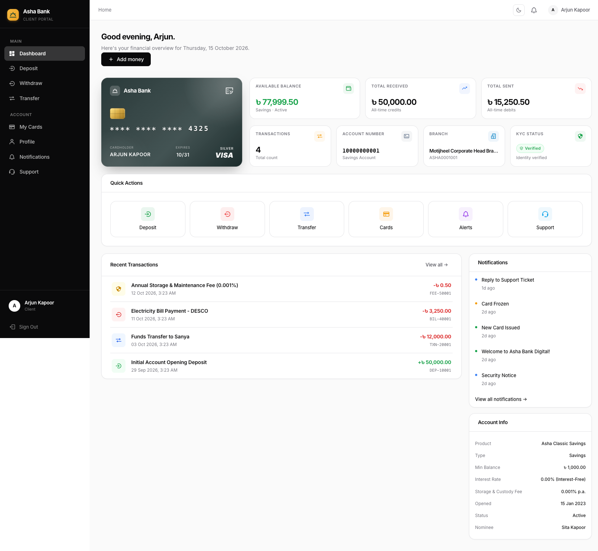
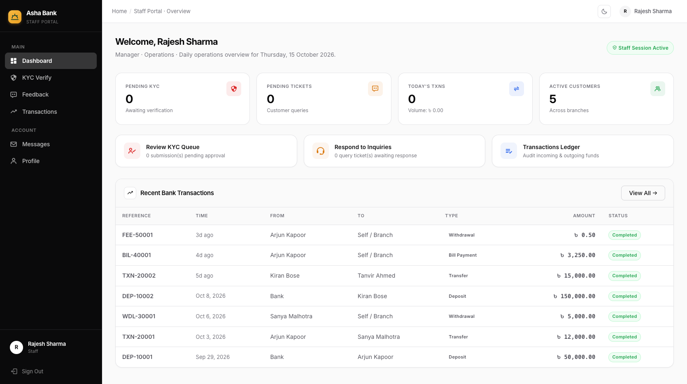
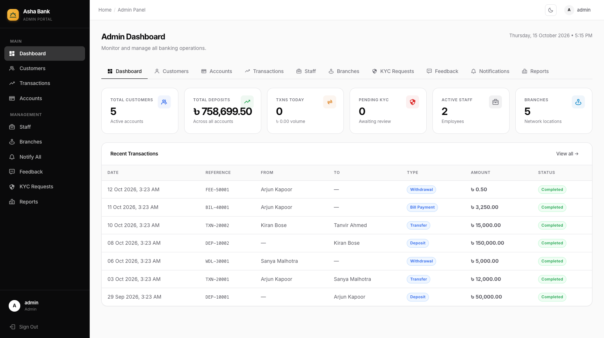
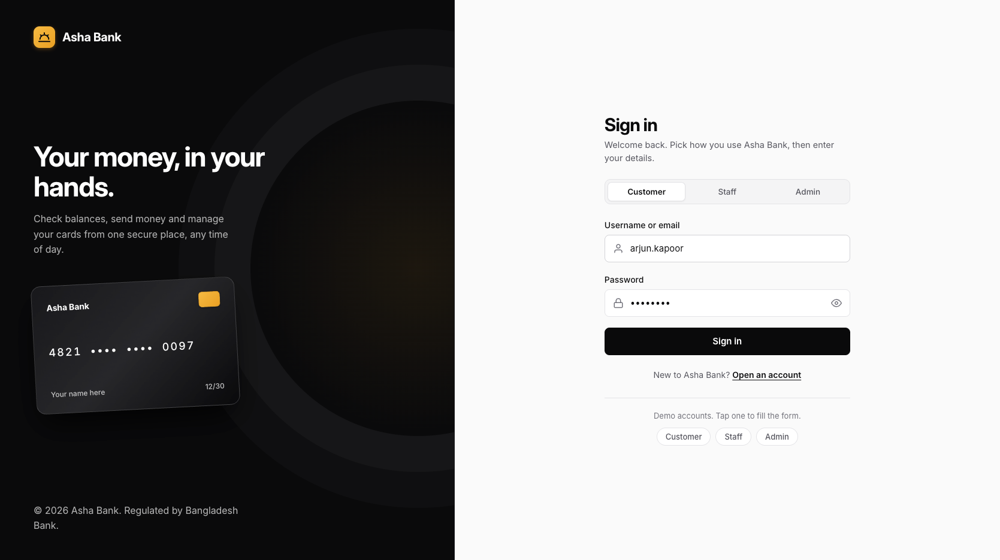
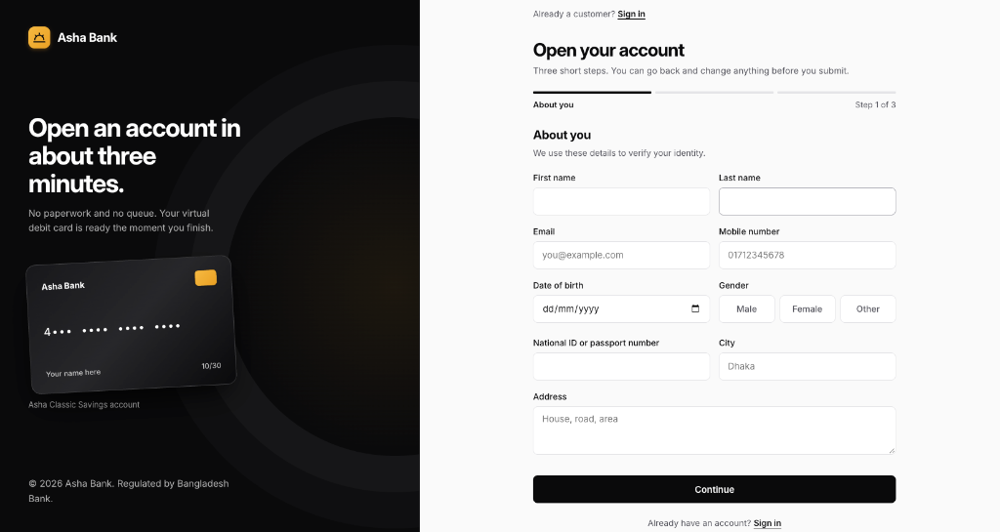

<div align="center">

# 🏦 Asha Bank

### Banking that grows with your hope
</div>

A full-stack **PHP / MySQL** digital banking platform with three role-based portals —
**Customer**, **Staff**, and **Admin** — wrapped in a dark, gold-accented, fully responsive UI.
<p>
  <a href="https://www.php.net/"><picture><source media="(prefers-color-scheme: dark)" srcset="https://shieldcn.dev/badge/PHP.svg?variant=secondary&size=sm&logo=php&logoColor=777BB4&mode=dark" /></picture></a>
  <a href="https://www.mysql.com/"><picture><source media="(prefers-color-scheme: dark)" srcset="https://shieldcn.dev/badge/MySQL.svg?variant=secondary&size=sm&logo=mysql&logoColor=4479A1&mode=dark" /></picture></a>
  <a href="https://developer.mozilla.org/en-US/docs/Web/JavaScript"><picture><source media="(prefers-color-scheme: dark)" srcset="https://shieldcn.dev/badge/JavaScript.svg?variant=secondary&size=sm&logo=javascript&logoColor=F7DF1E&mode=dark" /></picture></a>
  <a href="https://developer.mozilla.org/en-US/docs/Web/CSS"><picture><source media="(prefers-color-scheme: dark)" srcset="https://shieldcn.dev/badge/CSS.svg?variant=secondary&size=sm&logo=css&logoColor=1572B6&mode=dark" /></picture></a>
  <a href="https://github.com/armanhossen-dev/BMS"><picture><source media="(prefers-color-scheme: dark)" srcset="https://shieldcn.dev/badge/Status-Demo_Project.svg?variant=secondary&size=sm&mode=dark" /></picture></a>
</p>


[**Features**](#-features) ·
[**Screenshots**](#-screenshots) ·
[**Quick Start**](#-quick-start) ·
[**Demo Login**](#-demo-credentials) ·
[**Database**](#-database) ·
[**Roadmap**](#️-roadmap)


---

## 📖 About

**Asha** means *"hope"*. The product's identity — warm gold on near-black, and the tagline *"Banking that grows with your hope"* — is built around that idea.

Asha Bank is a complete banking management system covering the whole customer lifecycle: instant paperless onboarding, money movement, cards, loans, bills and cheques for customers; KYC review and support desk for staff; and liquidity analytics, account governance and broadcasts for administrators.

| | |
|---|---|
| **3** role-based portals | **37** database tables |
| **5** stored procedures · **6** functions | **5** triggers · **5** views |
| **EN / বাংলা** language toggle | **0** external chart libraries |

---

## 📸 Screenshots

### Customer Portal

> A wealth-management cockpit built for speed and transparency: aggregated balances, 7-day transaction velocity, and every banking service one click away.

<div align="center">

[](ss/client-dash.png)

</div>

### Staff & Admin Portals

<table>
  <tr>
    <th align="center">🛡️ Staff Operations</th>
    <th align="center">👑 Administrator Command Center</th>
  </tr>
  <tr>
    <td align="center"><sub>KYC queue · feedback inbox · admin escalations</sub></td>
    <td align="center"><sub>Liquidity reserves · 6-month flow · user controls</sub></td>
  </tr>
  <tr>
    <td><a href="ss/staff-dash.png"></a></td>
    <td><a href="ss/admin-dash.png"></a></td>
  </tr>
</table>

### Authentication & Onboarding

#### Unified Login (Client / Staff / Admin)

<div align="center">

[](ss/login.png)

</div>

#### Registration & Instant Card Issuance

<div align="center">

[](ss/Register.png)

</div>

### Landing Page (Dark Theme Showcase)

<div align="center">

[](ss/dark.png)

<sub>✨ High-contrast Dark Gold landing page showcase featuring instant digital onboarding, tiered card visualizers, real-time currency calculator, branch locator, and dual English / বাংলা language switching.</sub>

</div>

---

## ✨ Features

<details open>
<summary><b>👤 Customer Portal</b></summary>

<br>

| Module | What it does |
|---|---|
| **Dashboard** | Total balance, monthly received/sent, tier badge with star rating, canvas-drawn 7-day volume chart, account list, recent transactions |
| **Send Money** | Instant transfer between Asha Bank accounts with balance and status checks |
| **Deposit** | bKash · Nagad · Rocket · Upay · Branch, with method-specific reference fields |
| **Withdraw** | ATM · Branch · Mobile Banking |
| **Cards** | Auto-issued debit card, tier-styled gradient design, block/unblock, detail modal |
| **Profile** | Edit contact info, change password, submit KYC (NID + phone), nominees, referral code, request reactivation |
| **Feedback** | AJAX submission with live character counter and status history (`pending → read → replied → resolved`) |
| **Loans** | Home / Personal / Car / Education loans, live EMI calculator, application tracking, EMI payment against an amortization schedule |
| **Bill Pay** | Electricity · Water · Gas · Mobile · DTH · Insurance, optional recurring auto-pay flag, payment history |
| **Cheques** | Request a cheque book, track issued cheques, place stop-payments |

**Signature element — tiered debit cards.** Balance drives a customer's tier (*Classic → Silver → Gold → Platinum → Black Edition*). Each tier renders its own card gradient, star rating, and a progress bar toward the next tier.

</details>

<details>
<summary><b>🛡️ Staff Portal</b></summary>

<br>

- **Overview stats** — pending KYC, today's transactions, pending feedback
- **KYC review queue** — inspect NID documents, verify or reject with an audit-trailed reason; the customer is notified either way
- **Feedback inbox** — reply to customers; ticket status advances automatically
- **Admin escalation** — send messages, reports and requests up to Admin and read replies

</details>

<details>
<summary><b>👑 Admin Portal</b></summary>

<br>

- **Overview** — total customers, total reserve, total transactions, active staff, 7-day daily bar chart, 6-month deposits-vs-withdrawals chart, top 5 customers by volume, recent transactions
- **Customer management** — activate / deactivate with automatic notification
- **Staff management** — add, toggle active/inactive, delete
- **Staff messages** — approve / reject with a reply
- **Reactivation requests** — approve (auto-reactivates the account) or reject with reply and optional ETA
- **Broadcast** — push a notification to every active customer at once

</details>

<details>
<summary><b>🌐 Platform-wide</b></summary>

<br>

- **Notifications** — dropdown with unread badge, mark one/all as read (AJAX); auto-generated on transfers, deposits, withdrawals, large transactions, KYC decisions, card status changes and broadcasts
- **Multi-language** — English / বাংলা toggle, persisted in the session
- **Responsive** — sidebar collapses behind a hamburger menu on mobile; all grids stack to one column below 860px

</details>

---

## 🔐 Security

| Protection | Implementation |
|---|---|
| SQL injection | PDO prepared statements everywhere — no string-concatenated SQL |
| XSS | All dynamic output escaped through `clean()` (`htmlspecialchars`) |
| CSRF | Token on every state-changing form, verified with `hash_equals()` |
| Password storage | `password_hash()` (BCRYPT) |
| Brute force | 5 failed attempts → 15-minute lockout (customers and staff) |
| Session fixation | Session ID regenerated on every successful login |
| Data integrity | PDO transactions for money movement; DB triggers prevent negative balances |

> [!WARNING]
> This is a **learning / demo project**. Before any real deployment, add HTTPS everywhere, network-level rate limiting, a secrets manager (don't hardcode `DB_PASS`), CSP headers, and an independent security review of the stored procedures, triggers and KYC / reactivation approval flows. Remove `setup.php` and the demo accounts once the database is imported.

---

## 🧰 Tech Stack

| Layer | Technology |
|---|---|
| Backend | PHP 8.0+, PDO |
| Database | MySQL 5.7+ / MariaDB 10.3+ (JSON columns, triggers, stored procedures) |
| Frontend | HTML5, CSS3 (custom design tokens), vanilla JavaScript |
| Charts | Hand-rolled Canvas API (`drawLineChart` / `drawBarChart`) — no libraries |
| Typography | Outfit (display) · Inter (body) · JetBrains Mono (numerals) |
| Server | Apache, Nginx, or PHP's built-in server |

---

## 🚀 Quick Start

> [!TIP]
> **Instant Browser Demo (Zero Backend Required):**
> You can experience the complete interactive website and all 3 role portals without PHP or MySQL by opening [`index.html`](index.html) directly in your browser, or viewing the simulated modules in [`demo-web/`](demo-web/).

### Prerequisites (For Full PHP & MySQL Setup)

- PHP **8.0+** with the `pdo_mysql` extension
- MySQL **5.7+** or MariaDB **10.3+**
- Any web server (or PHP's built-in server for local testing)

### 1. Import the database

```bash
mysql -u root -p < database.sql
```

The schema uses `DELIMITER $$` blocks for stored procedures, functions, and
triggers — import via the **CLI** or **phpMyAdmin's Import tab**. A raw
multi-statement API call (like `mysqli::multi_query`) will not parse the
`DELIMITER` syntax correctly, which is why `setup.php`'s one-click import is
labeled "basic" and CLI import is the recommended path.

### 2. Configure the connection

Edit `config/db.php`:

```php
define('DB_HOST', '127.0.0.1');
define('DB_NAME', 'asha_bank');
define('DB_USER', 'root');
define('DB_PASS', '');
```

### 3. Set `BASE_URL`

Also in `config/db.php`:

```php
define('BASE_URL', '/BMS');
```

Change this if you deploy under a different folder name, or to `''` if the
app lives at your domain root.

### 4. Serve the app

```bash
# Quick local test
php -S localhost:8000

# Or point Apache/Nginx's document root at the project folder
```

Visit `index.php` (or just `/`) in your browser.

---

## 🔑 Demo Credentials

| Role   | Username        | Password    | Portal          |
|--------|-----------------|-------------|------------------|
| Admin  | `admin`         | `Admin@123` | `/admin/index.php` |
| Staff  | `rajesh`        | `password`  | `/staff/dashboard.php` |
| Client | `arjun.kapoor`  | `password`  | `/dashboard.php` |

Two more seeded clients: `sanya.malhotra` and `kiran.bose`, both with password
`password`.

---

<a id="-database"></a>
## 🗄 Database Overview

**37 tables**, organized into logical groups:

| Group | Tables |
|---|---|
| Geography | `ZONE`, `REGION`, `BRANCH` |
| Employees | `DEPARTMENT`, `DESIGNATION`, `EMPLOYEE` |
| System users | `ADMIN_USER`, `STAFF` |
| Customers | `CUSTOMERCATEGORY`, `CUSTOMER`, `NOMINEE` |
| Accounts | `ACCOUNTPRODUCT`, `ACCOUNT`, `JOINT_ACCOUNT_HOLDERS` |
| Cards | `CARDS` |
| Transactions | `TRANSACTIONTYPE`, `TRANSACTION`, `TRANSACTION_LIMITS` |
| Digital banking | `DIGITALBANKINGUSER` |
| Engagement | `NOTIFICATIONS`, `FEEDBACK` |
| Compliance | `KYC_VERIFICATIONS`, `REACTIVATION_REQUESTS` |
| Internal ops | `STAFF_MESSAGES` |
| Loans | `LOAN_PRODUCTS`, `LOANS`, `LOAN_EMI_SCHEDULE` |
| Bills | `BILL_CATEGORIES`, `BILL_PROVIDERS`, `BILL_PAYMENTS`, `BILL_AUTOPAY_SCHEDULES` |
| Cheques | `CHEQUE_BOOK_REQUESTS`, `CHEQUES` |
| Growth | `REFERRALS`, `REWARD_POINTS`, `REWARD_HISTORY` |
| Audit | `AUDIT_LOGS`, `TRANSACTION_AUDIT` |

**Also included:**
- 5 stored procedures — `sp_get_customer_statement`, `sp_transfer_money`,
  `sp_apply_monthly_interest`, `sp_calculate_loan_emi`, `sp_generate_emi_schedule`
- 6 functions — `fn_calculate_age`, `fn_get_customer_tier`,
  `fn_format_currency`, `fn_total_customer_transactions`, `fn_calculate_emi`,
  `fn_get_balance`
- 5 triggers — zero-balance auto-dormancy, balance-change audit log,
  large-transaction notification, negative-balance prevention, customer
  update audit log
- 5 views — `v_customer_balance_tier`, `v_daily_transaction_summary`,
  `v_account_summary`, `v_loan_summary`, `v_bill_payment_summary`
- Indexes — single, composite, and two full-text indexes (`CUSTOMER`,
  `TRANSACTION.Description`)

> **Note:** the PHP application layer performs transfers, deposits,
> withdrawals, and EMI payments directly with prepared statements inside
> `PDO` transactions (see `transfer.php`, `deposit.php`, etc.), rather than
> calling `sp_transfer_money`. Both paths are valid — the stored procedure is
> included in the schema for direct SQL/CLI use and as a reference
> implementation.

---

## 🎨 Design System

| Token | Value |
|---|---|
| Background | `#09090b` → `#1b1b1f` (layered near-black surfaces) |
| Accent | `#d4a657` warm gold (*Asha* = "hope") |
| Success / Danger / Warning / Info | `#4ade80` / `#f87171` / `#fbbf24` / `#60a5fa` |
| Display font | **Outfit** |
| Body font | **Inter** |
| Numerals | **JetBrains Mono** (account numbers, balances, card numbers) |

**Signature element:** tiered debit cards. Balance drives a customer's tier
(Classic → Silver → Gold → Platinum → Black Edition), and each tier renders
its own card gradient, a star rating, and a progress bar toward the next
tier — visible on the dashboard and the Cards page.

Charts are drawn with a small hand-rolled Canvas API (`drawLineChart` /
`drawBarChart` in `assets/js/main.js`) — no external chart library required.

---

## 🔒 Security Notes

- All queries use **PDO prepared statements** — no string-concatenated SQL.
- All dynamic output is escaped via `clean()` (`htmlspecialchars`).
- Every POST form carries a CSRF token, verified server-side with
  `hash_equals()`.
- Passwords are hashed with `password_hash()` (BCRYPT).
- Login attempts are rate-limited per account (5 attempts → 15-minute lock).
- Session ID is regenerated on every successful login.

This is a learning/demo project. Before any real deployment, add: HTTPS
everywhere, network-level rate limiting, a secrets manager (don't hardcode
`DB_PASS`), CSP headers, and an independent security review of the stored
procedures/triggers and the KYC/reactivation approval flows.

---

<a id="roadmap"></a><a id="️-roadmap"></a>
## 🗺️ Roadmap & Known Limitations

The core system (auth, accounts, transfers, cards, KYC, feedback, loans,
bills, cheques, and all three portals) is fully built and wired to the
database. Not yet implemented, and reasonable next additions:

- PDF/Excel statement and report export
- Tax certificates (TDS, interest certificates)
- Branch-wise performance and customer-acquisition reports
- Real SMS/Telegram/email delivery for KYC codes (currently demo-mode: the
  code is returned in the API response instead of sent)
- Bill auto-pay execution (the `BILL_AUTOPAY_SCHEDULES` table and the
  recurring checkbox exist; a scheduled job to actually run them does not)
- Reward points accrual logic (tables exist; no accrual trigger yet)
- Joint account holder management UI (table exists, no UI)
